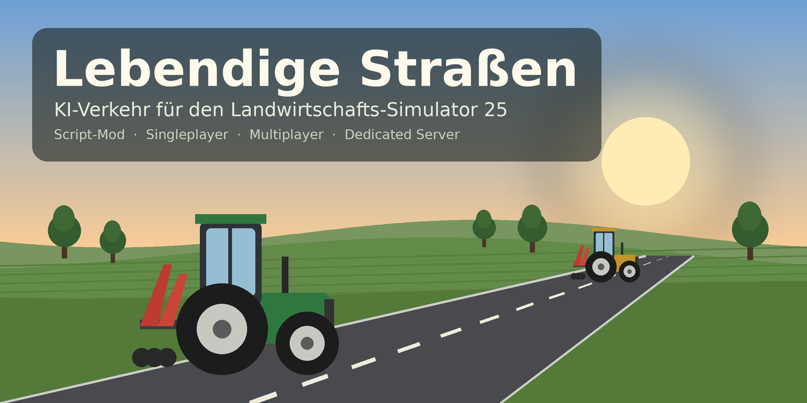

# Lebendige Straßen (FS25_LivingRoads)



Script-Mod für den Landwirtschafts-Simulator 25 (en „Living Roads“, fr „Routes Vivantes“). Die Nachbarn fahren mit
ihren Traktoren, teils mit Anbaugerät, über das KI-Straßennetz der Karte, halten an Wegpunkten, stellen sich eine Weile
ab und fahren weiter. Die Mod läuft auf jeder Karte, im Einzelspieler, im Multiplayer und auf dem Dedicated Server.

- Autor: OGW
- modDesc-Version: `1.0.0.0` (`descVersion` 113)
- Interner Stand: `NachbarFelderManager.BUILD = 180`, im Log als `LivingRoads: loadMap auf SERVER (Build 180)`

Maßgeblich ist die Build-Nummer, nicht die modDesc-Version.

Bis Build 178 hieß die Mod technisch `FS25_NachbarFelder`. Dateien aus `modSettings/FS25_NachbarFelder/` werden
weiter gelesen, solange es im neuen Ordner noch keine gibt (siehe unten).

## Bauen

```bash
py build.py
```

`build.py` packt seine feste Dateiliste zu `FS25_LivingRoads.zip` im Quellordner. Neue Dateien müssen dort in
`DATEIEN` eingetragen werden. Die ZIP wird nicht in den Mods-Ordner kopiert, das geschieht von Hand. Den Ordner selbst
nicht zippen: `modDesc.xml` muss in der ZIP ganz oben liegen. Den Dateinamen der ZIP nicht ändern, das Spiel nimmt ihn
als Mod-Namen.

### Release auf GitHub

`.github/workflows/release.yml` baut die ZIP und legt ein Release mit dem Tag `build<N>` an
(N = `NachbarFelderManager.BUILD`). Der Workflow läuft bei jedem Push auf `main`, bei einem gepushten Tag `build<N>`
und von Hand über **Actions → Release → Run workflow**. Gibt es das Release zur Build-Nummer schon, passiert nichts.

## Aufbau

| Datei | Inhalt |
|---|---|
| `NachbarFelder.lua` | Einstieg aus `extraSourceFiles`, lädt die übrigen Dateien, Netzwerk-Events, Tasten |
| `NachbarFelderManager.lua` | Spawn, Verkehr, Wegpunkte, Server-Konfiguration, Konsolenbefehle |
| `NachbarFelderWorker.lua` | Ende einer Fahrt auswerten (angekommen, nicht erreichbar, festgefahren) |
| `NachbarFelderSettingsPage.lua` | Einstellungen im ESC-Menü |
| `NachbarFelderWaypointPage.lua` | Reiter „Wegpunkte“ im ESC-Menü |
| `NachbarFelderWaypointDialog.lua`, `NachbarFelderUIHelper.lua` | Dialog und GUI-Hilfsfunktionen |
| `gui/` | GUI-Layouts und Profile |
| `help/` | Ingame-Hilfe mit Bildern; die Texte stehen im `l10n`-Block der `modDesc.xml` |
| `tools/` | Hilfsskripte, nicht Teil der ZIP (`hilfebilder.py` erzeugt die Bilder der Hilfe) |
| `docs/PROJEKTSTAND.md` | Arbeitsstand und Änderungen je Build |
| `docs/MODHUB_REGELN.md` | Was GIANTS bei der ModHub-Prüfung beanstandet |

## Bedienung

| Taste (Standard) | Wirkung |
|---|---|
| `Strg+Alt+L` | Alle Nachbar-Fahrzeuge entfernen (nur Admin) |
| `Strg+Alt+O` | Wegpunkt an der eigenen Position setzen |
| `Strg+Alt+U` | Zuletzt gesetzten Wegpunkt entfernen |
| `Strg+Alt+C` | Wegpunkte nacheinander anzeigen |

Die Tasten lassen sich unter Einstellungen → Steuerung ändern. Einstellungen gibt es unter ESC → Einstellungen im
Abschnitt „Lebendige Straßen“, Wegpunkte und Spawnpunkte im Reiter **Wegpunkte**, eine Kurzanleitung unter
ESC → Hilfe → „Lebendige Straßen“.

Am zuverlässigsten starten die Fahrzeuge von einem eigenen Spawnpunkt. Er wird am besten im Traktor auf der rechten
Spur gesetzt, mit der Front in Fahrtrichtung. Ohne Spawnpunkt sucht die Mod selbst einen freien Platz an einer
KI-Straße.

Wegpunkt-Typen: 0 Normal, 1 Kurz, 2 Lang, 3 Durchfahrt, 4 Spawnpunkt.

### Konsolenbefehle

| Befehl | Wirkung |
|---|---|
| `nachbarFelderTimer` | Zeit bis zum nächsten Spawn |
| `nachbarFelderEntfernen` | Alle Nachbar-Fahrzeuge entfernen |
| `nachbarFelderTrafficStop` / `nachbarFelderTrafficStart` | Verkehr anhalten bzw. wieder zulassen |

### Spielverkehr

Die Autos des Spielverkehrs bremsen nur für Objekte, die bei ihnen angemeldet sind. Die Mod meldet ihre Traktoren und
Geräte beim Losfahren an und beim Abstellen, Löschen und Spielende wieder ab. Abschalten lässt sich das in der
Server-Konfiguration mit `spielverkehrAnmelden` = `false`. Auf Minimap und Karte haben die Nachbar-Fahrzeuge kein
Helfer-Symbol.

## Einstellungen und Daten

Im Profil unter `modSettings/FS25_LivingRoads/`:

- `NachbarFelderServerConfig.xml`: Server-Einstellungen (Verkehrsdichte, Fahrzeugkategorien, Spawn-Abstände,
  `aufraeumenMinTage`, `logLevel` 1 oder 2)
- `NachbarFelderWaypoints_<KartenId>.xml`: Wegpunkte je Karte
- `NachbarFelderLadeplaetze_<KartenId>.xml`: Ladeplätze an der KI-Straße, an denen Fahrzeuge nicht wegkamen. Sie
  werden auf dieser Karte nicht mehr benutzt; zum Freigeben die Datei löschen.
- `NachbarFelderClient.xml`, `NachbarFelderSetting.xml`: Anzeige- und Menüeinstellungen

Fehlt eine dieser Dateien, liest die Mod sie aus dem alten Ordner `modSettings/FS25_NachbarFelder/`. Gespeichert wird
immer im neuen Ordner. Die Server-Konfiguration schreibt die Mod nie selbst; wer sie angepasst hat, verschiebt sie am
besten von Hand in den neuen Ordner.

## Fehler melden

Fehler und Vorschläge bitte über **Issues** melden, dort gibt es Vorlagen für beides. Hilfreich sind:

- die Build-Nummer aus dem Log (`LivingRoads: loadMap auf SERVER (Build …)`),
- die Karte und ob Einzelspieler, eigener Host oder Dedicated Server,
- die Log-Zeilen rund um das Problem, also alles, was mit `LivingRoads:` beginnt.

Das Log liegt unter `%USERPROFILE%\Documents\My Games\FarmingSimulator2025\log.txt`, beim Dedicated Server im Profil
des Servers. **Bitte vor dem Einfügen persönliche Daten entfernen**: Logs enthalten Benutzernamen, Pfade und im
Multiplayer auch Spielernamen.

Ohne Debug-Log schreibt die Mod nur Warnungen, Fehler und die Startzeile ins Log. Für die Fehlersuche unter
ESC → Einstellungen → Lebendige Straßen → **Debug-Log** einschalten (Admin, gilt für Server und alle Spieler) oder
`logLevel` = `2` in der Server-Konfiguration setzen.

## Lizenz und Nutzung

Alle Rechte liegen beim Autor. Die Mod darf gespielt und der Code gelesen werden. Weiterverbreitung, auch verändert oder
als Teil einer Sammlung, bitte vorher absprechen.

## Hinweise für die Weiterarbeit

- Vor jeder Auslieferung die Lua-Syntax prüfen (Strukturcheck und vollständiger Parse), kein `pcall`.
- Textdateien sind UTF-8. Nicht mit PowerShell `Get-Content`/`Set-Content` bearbeiten, das zerstört die Umlaute.
- Die KI fährt nicht entlang der Straßen-Splines, sondern über den Navigations-Agenten der Engine (`AIDrivable`).
  `AIMessageErrorNotReachable` kommt von dort.
- KI-Straßen sind Einbahnen; der Gegenverkehr läuft über die Zwillings-Spline mit „R“ im Namen. Fahrzeug oder Ziel nie
  um 180 Grad gegen die Spline drehen.
